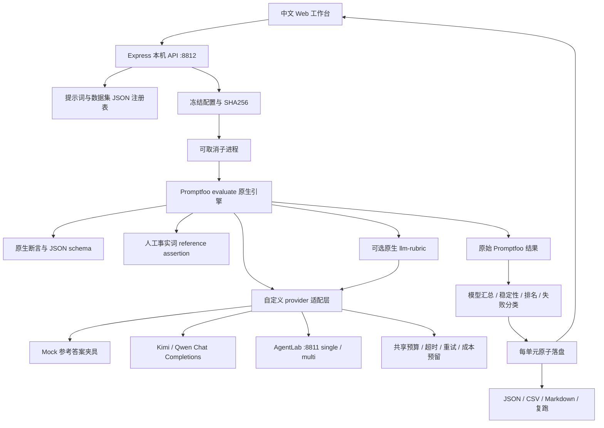

# LLM Benchmark Studio

一个基于 **Promptfoo 0.124.1** 的本地中文评测工作台。它调用 Promptfoo 的原生 `evaluate()`、`is-json`、`contains`、`javascript` 和可选 `llm-rubric`，围绕原生引擎提供提示词版本、数据导入、冻结配置、稳定性、失败案例和实验审计。

**当前已验证的是 Mock 流水线与本地 HTTP/HTTPS 协议夹具，没有运行 Kimi、Qwen 或 Judge 的真实云端模型实验。** Mock 模型直接读取人工参考答案，含预置错误；这些分数不能证明模型能力或 Agent 架构优劣。真实模型接入代码已实现，需使用你自己的环境配置并单独运行。

## 5 分钟运行

需要 Node.js **22.22.0+**，推荐 Node.js 24 LTS。当前开发验证为 Windows / Node 24.16.0。安装依赖会访问 npm。

```bash
npm ci
npm start
```

浏览器打开 <http://127.0.0.1:8812>。Windows 也可双击 `启动.cmd`，Git Bash / macOS / Linux 可执行 `bash start.sh`。默认仅监听本机，不需要 API Key。页面选择默认两个 Mock provider、三种提示词、12 道研究题、重复两次，点击「开始评测」得到 **144 个实际执行的 Promptfoo 单元**。

```bash
npm test              # 核心、原生 Promptfoo、HTTP 夹具、API 完整流程
npm run demo          # 命令行运行 144 单元 Mock 演示
npm run replay -- <实验ID>
npm run replay -- reports/mock-2026-10-14/snapshot.json
```

`npm start` 直接读取进程环境；如果使用 `.env` 文件，运行 `bash start.sh` / `启动.cmd`，或者：

```bash
node --env-file-if-exists=.env src/server.js
```

首次依赖安装在本机约 3 分钟，Promptfoo 为完整依赖，磁盘体积明显大于本项目源码。启动不需要编译前端，也不使用外部字体或 CDN。

## 已实现功能

| 功能 | 行为 |
|---|---|
| 多模型 | 两个清晰标记的 Mock provider；Kimi / Qwen OpenAI 兼容 Chat Completions；AgentLab single / multi HTTP provider |
| 提示词 | 默认直接回答、结构化证据、交叉核查三策略；创建、编辑生成版本、历史、删除；旧实验保留原文 |
| 数据集 | CSV / JSON 导入、必填校验、重复ID校验、JSON参考结构校验、安全断言白名单；1–200题 |
| 批量实验 | 模型 × 提示词 × 题目 × 重复次数；最大1500单元；缓存关闭；有限并发 |
| 规则评价 | Promptfoo 原生断言；JSON任务要求字段、字段类型、不允许额外字段 |
| 参考评价 | 人工参考事实词覆盖，逐项命中依据可查看；不把覆盖率称为语义准确率 |
| 可选语义评审 | 原生 `llm-rubric`，固定Qwen judge、rubric、温度0；独立分数与原始理由；调用计入共享预算 |
| 指标 | 任务通过率、JSON合规、事实词覆盖、可选Judge分、延迟、服务端usage Token、已配置价格成本、重复输出稳定性 |
| 分析 | 模型图表、提示词敏感性、难度分层、可调权重排行榜、评分覆盖率 |
| 失败案例 | 原始输出、完整断言理由、错误与来源、人工改分类和复核说明；保留自动评分 |
| 可复现 | 冻结模型/端点/参数/价格、提示词版本、数据与hash、断言、源码hash、时间、原始SDK结果与ledger |
| 导出 | JSON、CSV、Markdown、原生Promptfoo配置与原始结果；CSV防公式注入 |
| 恢复 | 每单元落盘、取消保留已完成结果、服务重启标记interrupted、复跑新建实验、不覆盖原记录 |

## 架构与数据流



```text
src/
  server.js              HTTP API、本机访问防护、导出
  storage.js             原子JSON持久化、ID、hash
  seeds.js / datasets.js 默认资料、导入与校验
  models.js / config.js  模型注册、配置冻结、原生Promptfoo套件生成
  runner.js / worker.js  子进程调度、取消、恢复、原生引擎执行
  provider.js            Mock/实时HTTP/AgentLab适配、重试与共享预算
  reference-assertion.js Promptfoo执行的人工事实词断言
  analysis.js            缺失值、稳定性、排名、报告
public/                   无构建步骤的中文界面
examples/                 12道研究探针、CSV模板、原生Judge参考片段
tests/                    核心、原生引擎、HTTP传输、API流程
reports/                  已实际运行的Mock报告与复现快照
data/                     本机运行时数据；Git忽略
```

## 真实模型配置

复制 `.env.example` 为 `.env`，只在本机填写，不提交密钥：

```dotenv
KIMI_API_KEY=你的密钥
KIMI_BASE_URL=https://api.moonshot.cn/v1
KIMI_MODEL=你账户可用的模型或固定版本
QWEN_API_KEY=你的密钥
QWEN_BASE_URL=https://dashscope.aliyuncs.com/compatible-mode/v1
QWEN_MODEL=你账户可用的模型或固定版本
STUDIO_ENABLE_LIVE=1
```

不同账号、区域和时间可用的模型与端点可能不同，请按供应商账号文档核对；仓库默认模型名称只是可修改的配置。界面高级设置可以修改非秘密的模型版本、端点、输入/输出USD每百万Token价格。密钥只读取固定环境变量，不返回前端，不写冻结配置。

实时调用需要同时满足：服务环境 `STUDIO_ENABLE_LIVE=1`、相应Key已配置、选择实时provider、勾选当次费用授权。默认不会偷偷调用云端服务。所有保存的报告都明确标注执行模式。

Node 24 的子进程启用 `NODE_USE_ENV_PROXY=1`，继承本机 HTTP(S)_PROXY，并把 localhost / 127.0.0.1 加入 NO_PROXY；不记录代理凭据。若账号网络环境不需要代理，留空即可。

### 超时、重试与成本

- 平台请求上限 `max_calls` 包括生成、重试和Judge；最大重试2次，429/5xx/网络超时有限退避，400等请求错误不盲目重试。
- 每次请求受单次超时和实验剩余时间限制；实验另有总超时。取消终止子进程，父服务断开也停止worker。
- 已知价格时并发调用先预留保守成本，再发送请求。美元预算要求所有启用的实时provider（包括Judge）都配置价格；价格未知时用调用预算。
- API失败可能已经计费，因此失败尝试保留保守预算承诺。重试后成功单元的**整体Token与成本仍记未知**，`successful_attempt_*`保留成功那次已知usage，不把它冒称整个单元的总费用。
- 每模型表格只统计生成Token/费用，**不含Judge**。`cost_audit`单列Judge请求/费用、实验总费用和已知覆盖率；只要任一尝试费用未知，完整总费用是null。`known_cost_subtotal_usd`仅是已知小计。
- AgentLab每题内部模型调用由其 `agent_max_calls`约束；平台上限是外层HTTP请求数。内部调用数量另记 `agent_internal_model_calls`，不能混加或声称为同一种预算。

## 如何解释评分

**规则**检查预定义要求；**参考事实词**只是人工事实清单的覆盖探针。它可能漏掉同义表达，也可能把包含关键词但上下文错误的答案判通过。任何事实结论都应人工阅读原始输出并核验来源。

要进行语义评审，可在实时实验中启用固定Qwen Judge，工作台通过Promptfoo原生 `llm-rubric`调用同一预算适配层。Judge模型、端点、rubric、温度和价格都冻结。评分与理由保存在 `grading.componentResults`，`judge_score`单独记录。Judge故障标记「评估失败」、Judge分为null、从质量分母剔除并显示覆盖率；不会把预算耗尽包装成模型回答错误。

Judge可能存在位置、风格、同源和幻觉偏差。建议随机抽样人工复核，尤其检查事实与引用。一次“审查通过”或Judge高分不能代替外部事实核验。

稳定性定义为每个同模型/同题/同提示词重复组中**完全相同原始输出的众数比例**，再汇总。组数未完成、未达到预设重复次数或没有可用输出时不作完整稳定性结论。它对无关标点变化也敏感；稳定地重复错误仍会很稳定，不能叫准确率。

加权排行榜的质量、速度、成本、稳定性权重由用户选择。任何启用维度缺失，该模型不参与完整综合排名；默认Mock成本未知，所以默认成本权重为0。排名是该样本与主观偏好下的计算，不是客观模型实力榜。

## 数据导入与人工复核

CSV模板见 `examples/import-example.csv`，JSON示例见 `examples/research-cases.json`。每条样本必须有 `question`、人工`reference`和`facts`；`facts`在CSV用`|`分隔，JSON用字符串数组。可选 `difficulty`、`expect_json`、`assertions`、`source_urls`。

仅接受 `contains`、`icontains`、`not-contains`、`equals`、`is-json`断言，导入不会执行任意JavaScript。JSON任务的参考答案须是字符串字段对象，原生schema据此约束同名必需字段和类型。

示例12题是3道简单、5道中等、4道困难的**小型工程/方法学探针**，不代表所有深度研究任务。R05/R09/R11包含作者预设方法清单，官方文档链接只是配置或概念背景；不能把它当逐句权威证明。来源链接是人工复核入口，未自动证明URL持续可访问或支持模型的每个论断。

在输出明细点击「查看 / 复核」，核对原始输出、原生断言、参考答案、来源和trace；完成或取消实验后可保存人工分类与说明。自动评分保持原样。CSV导出会对可能被Excel当公式的字符串加单引号，JSON保留原始文本。

## AgentLab 联动

先独立启动AgentLab（<http://127.0.0.1:8811>），点击「AgentLab 单 / 多对照」。两架构接受相同题目、模型provider、temperature、研究策略、每题内部调用预算和超时。调用契约：

```json
{
  "task_id":"实验-题目-重复-单元hash",
  "question":"原始问题（检索用）",
  "research_instructions":"已渲染提示词（模型用）",
  "mode":"single",
  "execution_mode":"mock",
  "provider":"qwen",
  "temperature":0,
  "max_calls":8,
  "timeout_seconds":30
}
```

响应要求 `schema_version:"1.0"`，包含`output`、`sources`、`metrics`与`trace`；`success:false`会保存为失败。模型、模式、提示词、重复次生成独立task_id，同一单元重试保持task_id与任务配置一致。AgentLab返回研究策略hash和provider冻结信息用于核对。

真实公平比较还要控制搜索工具与来源快照，按难度分层、人工核验事实与引用，记录外部网页变化。集成接口和Mock结果只能证明工程闭环；本轮没有真实云端单/多Agent质量比较，也没有预注册推断检验，不宣称普遍优越或统计显著。

## 持久化、恢复与复现文件

`data/library.json`保留当前注册表。每个`data/runs/<实验ID>/`包含：

| 文件 | 内容 |
|---|---|
| `snapshot.json` | 完整冻结模型、提示词、数据、参数、评估标准、hash和时间 |
| `promptfooconfig.json` | 实际交给Promptfoo的配置；cache:false |
| `state.json` | 运行状态、已完成数、错误与结束时间 |
| `rows.json` | 已完成单元、原始输出、断言、人工标注 |
| `raw-results.json` | 最终Promptfoo `toEvaluateSummary()`原始结果 |
| `ledger.json` | 各次平台请求、重试、usage、Judge与预算承诺 |
| `report.json` / `report.md` / `results.csv` | 完成时生成的报告；API导出实时采用最新人工标注 |
| `engine.log` | 引擎错误与执行信息，不保存HTTP错误正文 |

关键文件原子替换，辅助ledger损坏不会阻止读取/导出已完成rows。服务重启把遗留running/queued标为interrupted，保留内容；点击复跑使用冻结样本、提示词、模型和参数生成新ID，调用会重新执行，旧记录不覆盖。**这是安全重跑，不是自动续接半次模型调用。** 实时重跑仍须授权。源文件hash便于审计；如果源码或供应商后端版本变化，结果仍可能变化。

## API 与测试

`GET /api/health`、`GET /api/library`；提示词`POST/DELETE /api/prompts`；数据集`POST/DELETE /api/datasets`；实验`POST/GET /api/runs`、`GET /api/runs/:id`、`POST .../cancel`、`POST .../replay`；复核`PATCH .../rows/:rowId`；导出`GET .../export/{json,csv,markdown,config,raw}`。

```json
POST /api/runs
{"name":"Mock比较","dataset_id":"research-12","model_ids":["mock-kimi","mock-qwen"],"prompt_ids":["direct","structured","verify"],"repeats":2}
```

本地自动化13项测试已通过，覆盖24单元原生Promptfoo矩阵、JSON错误字段、导入拒绝、配置冻结、未知指标、未完成重复组与未启动单元、Judge基础设施失败、HTTP429重试/400终止、并发成本预留、API实验/标注/导出/复跑/取消/恢复以及跨站写入拒绝。测试HTTP服务是本机夹具，不使用云端模型Key。GitHub Actions定义了Windows/Ubuntu Node24检查；远端CI实际状态以仓库Actions为准。

## 框架依据与范围

开发前核验npm registry稳定版`promptfoo@0.124.1`及Node要求；SDK的`evaluate()`返回Eval记录，再`await record.toEvaluateSummary()`。官方依据：[Node包](https://www.promptfoo.dev/docs/usage/node-package/)、[Node API](https://www.promptfoo.dev/docs/usage/node-api-reference/)、[配置](https://www.promptfoo.dev/docs/configuration/reference/)、[断言](https://www.promptfoo.dev/docs/configuration/expected-outputs/)、[Judge偏差](https://www.promptfoo.dev/docs/guides/llm-as-a-judge/)。

没有多用户登录、分布式调度或多租户隔离；只用于可信本机实验。默认关闭Promptfoo遥测、更新检查与共享，评测数据不主动上传；开启实时provider才会把所选问题/提示词发送给模型服务。源码MIT许可。

## 2 分钟演示顺序

0:00–0:20：说明Mock标识与配置矩阵；0:20–0:45：运行并观察逐单元进度；0:45–1:10：比较通过率、稳定性与提示词；1:10–1:30：查看失败案例并保存人工复核；1:30–1:45：导出JSON/Markdown；1:45–2:00：展示提示词版本、CSV导入与AgentLab对照入口。展示的必须是实际界面操作；真实能力结论需要另行实调实验。
